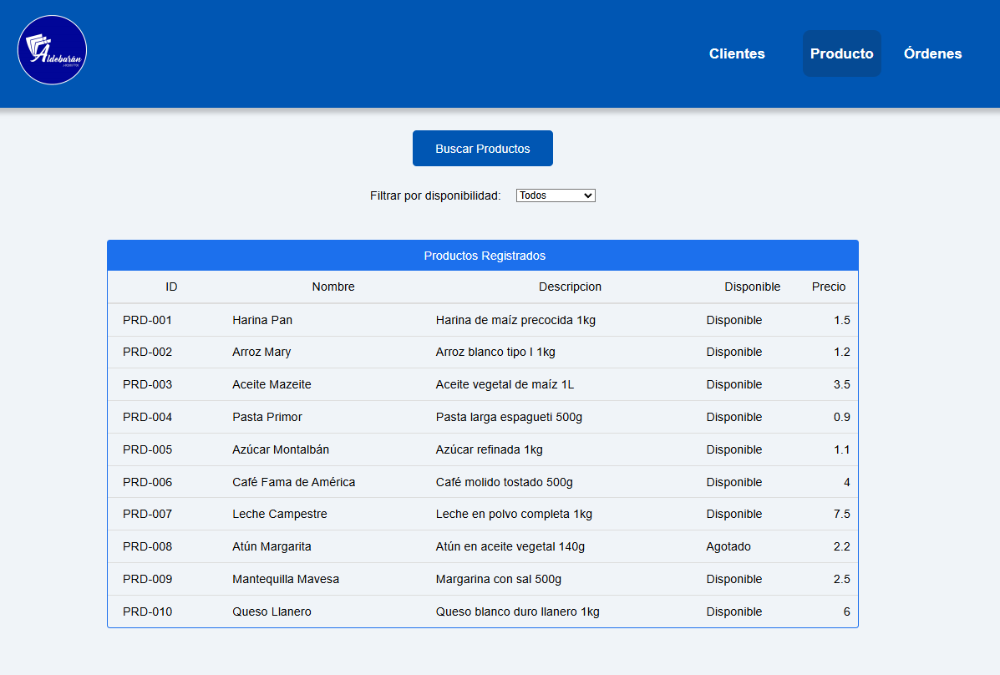
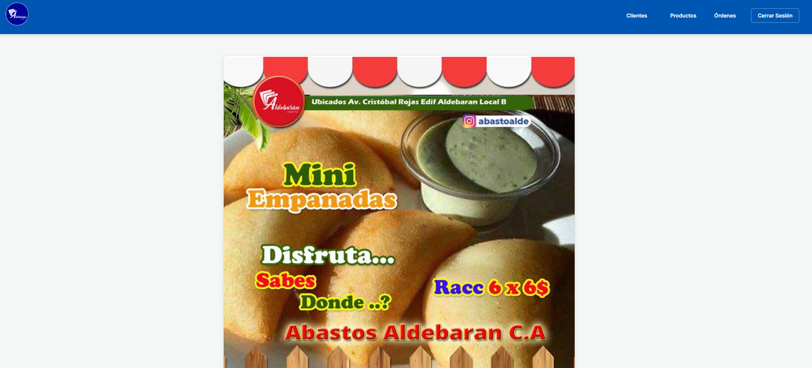

# PedidosAbastoAlbedaran (API Rest) 🚀

> Un sistema de gestión de pedidos y control de abastos para Albedarán, impulsado por una robusta API REST en Spring Boot.


## 📌 Descripción
**PedidosAbastoAlbedaran** es una aplicación backend (con vistas estáticas integradas) diseñada para optimizar y gestionar el flujo de pedidos de un centro de abastos. Proporciona una interfaz programática (API REST) para manejar el inventario, realizar órdenes y gestionar operaciones de forma eficiente.

## 🏗️ Arquitectura y Stack Tecnológico
- **Lenguaje:** Java 23
- **Framework Principal:** Spring Boot 3.3.7
- **Base de Datos:** H2 (In-Memory Database) para pruebas locales y despliegue rápido sin configuración externa.
- **ORM:** Spring Data JPA (Hibernate)
- **Construcción:** Maven (incluye `mvnw` Wrapper)
- **Frontend Embebido:** Archivos estáticos servidos desde `/view`, `/css`, `/img`, y `/scripts` directamente por el servidor web integrado (Tomcat).

## ✨ Características Principales (Features)
- API RESTful completa para la gestión de recursos de abasto.
- Diseño sin dependencias externas complejas (base de datos H2 en memoria).
- Servidor web estático incluido para renderizado rápido de interfaces cliente.
- Actuadores de Spring Boot integrados para monitoreo del estado de la aplicación.
- Listo para ejecutar en cualquier entorno con Java 23.

## 🚀 Instalación y Uso (Local)

Sigue estos pasos para poner a funcionar el proyecto en tu máquina local:

### 1. Prerrequisitos
- Tener instalado **Java 23** (o superior). Asegúrate configurando tus variables de entorno (`JAVA_HOME`).
- No se requiere instalar base de datos externa, ya que utiliza H2 en memoria.

### 2. Clonar el repositorio
```bash
git clone <URL_DEL_REPOSITORIO>
cd PedidosAbastoAlbedaran/ApiRestSB
```

### 3. Configuración (Opcional)
Puedes habilitar la consola de la base de datos H2 para inspeccionar los datos directamente agregando la siguiente línea en `src/main/resources/application.properties`:
```properties
spring.h2.console.enabled=true
```
*(Podrás acceder a ella desde `http://localhost:8080/h2-console`)*.

### 4. Ejecutar la aplicación
Puedes utilizar el wrapper de Maven incluido para no tener que instalar Maven globalmente:

**En Windows:**
```cmd
.\mvnw.cmd spring-boot:run
```

**En Linux / Mac:**
```bash
./mvnw spring-boot:run
```

### 5. Acceso
- **API y Frontend:** La aplicación se levantará en el puerto 8081 por defecto. Puedes visitar `http://localhost:8081/` para ver la interfaz gráfica servida desde los recursos estáticos.

## 📸 Capturas de Pantalla (Portafolio)

A continuación, algunas vistas de la aplicación funcionando:

### Inicio de Sesión


### Menú Principal y Dashboard


### Consola de Base de Datos H2

